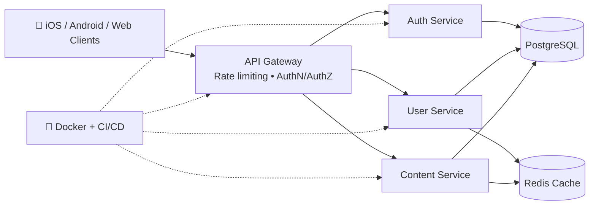

<!-- ============================================================
  TODO antes de publicar (busca "TODO" y reemplaza):
  - Links de repos de proyectos, YouTube, TikTok, portafolio
  - Agrega métricas REALES (descargas, usuarios, estrellas) donde dice TODO
  ============================================================ -->

 

---

## ⚡ TL;DR

> **Software engineer who owns the whole stack.** I build polished native Apple apps (Swift / SwiftUI / UIKit / Objective-C), Android apps (Kotlin / Java), high-performance backends (Go, Rust, C#, Node.js) and I think like an attacker when I design systems, so what I ship is fast, scalable **and secure**.

| | |
|---|---|
| 🎯 **Primary role** | iOS / macOS Software Engineer |
| 🧩 **Also** | Android • Backend • Cybersecurity • Systems programming (C / C++ / Rust) |
| 🌎 **Based in** | Ensenada, Baja California, México (open to remote / relocation) |
| 🗣️ **Languages** | Spanish (native) • English (professional) <!-- TODO: ajusta nivel --> |
| 📬 **Status** | **Open to full-time, freelance and collaboration** |

---

## 🧰 Tech Stack

**📱 Mobile**

 
Swift • SwiftUI • UIKit • Objective-C • Combine • Kotlin • Java • Android SDK

**⚙️ Backend & Systems**

 
Go • Rust • C# / .NET • C++ • Node.js • Shell / Bash

**🌐 Web**

 
TypeScript • JavaScript • React

**🗄️ Data & Infra**

 
PostgreSQL • MongoDB • Redis • Docker • Linux • Git • CI/CD

**🛡️ Security**

Secure coding • Threat modeling • OWASP Mobile / Web Top 10 • Authentication & authorization • Secrets management • Network & API hardening

<b>📋 Full keyword list (click to expand)</b>

 

**Languages:** Swift, Objective-C, Kotlin, Java, Go (Golang), Rust, C#, C++, TypeScript, JavaScript, Shell (Bash/Zsh)
**Mobile:** iOS, macOS, SwiftUI, UIKit, Combine, async/await, Core Data, URLSession, Android SDK, MVVM, Clean Architecture
**Backend:** REST APIs, microservices, concurrency, caching, authentication (JWT / OAuth2), PostgreSQL, MongoDB, Redis
**DevOps:** Docker, CI/CD, GitHub Actions, Linux, Git
**Security:** Application security, secure SDLC, OWASP, penetration-testing fundamentals, cryptography basics, secure API design
**Practices:** Unit & integration testing, code review, system design, algorithms & data structures, performance profiling

---

## 🚀 What I'm Focused On Right Now

- 🧠 **AI-powered apps**: streaming LLM clients, on-device and cloud inference on Apple platforms
- 🌐 **Distributed systems**: designing resilient backends in Go and Rust
- 🏗️ **SwiftUI architecture**: scalable, testable patterns for large apps
- 🛡️ **Security engineering**: building defenses by understanding attacks

---

## 🔥 Featured Projects

<table>
<tr>
<td width="33%" valign="top">

### 🤖 AI Chat App
**SwiftUI • Combine • OpenAI API**

Native AI chat client with real-time **streaming responses**, clean architecture and a smooth modern UI.

- Token-by-token streaming
- Scalable message handling
- Modular, testable layers

[**View repo →**](https://github.com/ruvalcaba18) 

</td>
<td width="33%" valign="top">

### ⚡ Scalable API
**Go • PostgreSQL • Docker**

High-performance REST backend built with a clean service architecture, ready for cloud deployment.

- Low-latency endpoints
- Modular service design
- Containerized & CI-ready

[**View repo →**](https://github.com/ruvalcaba18) <!-- TODO: link directo -->

</td>
<td width="33%" valign="top">

### 🧮 Algorithms & Data Structures
**Multi-language**

Implementations inspired by *Cracking the Coding Interview* and system design practice.

- Graphs, bit manipulation, DS
- Complexity analysis
- Interview-grade solutions

[**View repo →**](https://github.com/ruvalcaba18) <!-- TODO: link directo -->

</td>
</tr>
</table>

> 💡 **Tip:** pin your 6 best repos on your profile and give each one a one-line description, a topic list and a screenshot or GIF.

---

## 🏗️ How I Architect Systems

**Principles I build by:** clean boundaries • security by default • observability • fast native UX • simple over clever.

---

## 📊 GitHub Stats

---

## 🎥 Content & Engineering Videos

I teach what I build: SwiftUI architecture, backend engineering, algorithms, system design, security and AI integrations.

 <!-- TODO: link YouTube -->
 <!-- TODO: link TikTok -->

---

## 🤝 Let's Work Together

I'm open to **full-time roles, freelance projects and collaborations** in:

- 📱 iOS / macOS / Android app development
- ⚙️ Backend & API engineering
- 🛡️ Secure architecture & code review
- 🤖 AI-powered product prototypes

### 📬 **[jael.ruvalcaba@uabc.edu.mx](mailto:jael.ruvalcaba@uabc.edu.mx)** • **[LinkedIn](https://www.linkedin.com/in/jael-ruvalcaba/)**

⭐ *If you like what you see, follow me or open an issue. I reply fast.*

⭐ If you like my projects feel free to **follow or collaborate**
